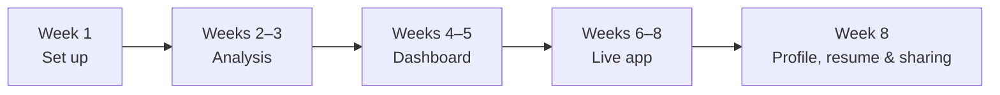

# Data-Analytics-Portfolio
| A practical, eight-week plan for turning guided coursework into a public data portfolio that recruiters and collaborators can explore.

## Purpose

Tutorial and guided projects build important technical skills. A portfolio shows how you apply those skills independently: choosing a question, finding data, communicating insight, and publishing work that others can use.

This roadmap focuses on three finished, public projects rather than a large collection of incomplete ones. It is designed to fit around school or other commitments with a few focused hours each week.

## Roadmap at a Glance

| Stage | Timeline | Deliverable | What It Demonstrates |
| --- | --- | --- | --- |
| Set up | Week 1 | GitHub profile and working tools | Professional online presence |
| Project 1: Analysis | Weeks 2–3 | Public notebook and project README | Data cleaning, EDA, and storytelling |
| Project 2: Dashboard | Weeks 4–5 | Interactive public dashboard | Communication for non-technical audiences |
| Project 3: Live app | Weeks 6–8 | Deployed Streamlit app | Building and launching a usable product |
| Wrap up | Week 8 | Updated profile, résumé, and project posts | Clear presentation of your work |

## 1. Set Up Your Workspace

Start with a simple, reliable toolkit. You do not need expensive software to publish strong work.

| Need | Recommended tools |
| --- | --- |
| Code, version history, and project hosting | GitHub |
| Browser-based Python environment | Google Colab |
| Local development (optional) | VS Code |
| Datasets and public notebooks | Kaggle |

### Create a GitHub profile README

Create a repository with the same name as your GitHub username. Its `README.md` appears at the top of your GitHub profile. Keep it human and brief:

- Who you are and the kind of data work you are learning or pursuing
- Your key tools or current focus
- Links to your best projects
- A way to connect with you, such as LinkedIn or email

## 2. Project One: Independent Data Analysis

**Goal:** complete one end-to-end analysis about a question you genuinely care about.

Start with a question—not a dataset. A local or Africa-focused topic can make the work more distinctive while helping you discuss a subject you understand.

### Example questions

- How has internet access changed across African countries?
- Which factors are associated with student performance in a public dataset?
- How have fuel or food prices changed over time?
- What factors are related to life expectancy across countries?

### Free data sources

| Source | Best for |
| --- | --- |
| Kaggle Datasets | Wide variety of ready-to-use datasets |
| World Bank Open Data | Economy, education, health, and country indicators |
| Our World in Data | Clean, documented global datasets |
| Google Dataset Search | Discovering data on a specific topic |

### The analysis workflow

1. **Ask:** define one clear, answerable question.
2. **Acquire:** download or collect relevant data and record its source.
3. **Clean:** address missing values, duplicates, incorrect types, and obvious quality issues.
4. **Explore:** use summaries and exploratory analysis to understand patterns.
5. **Visualize:** create three to five charts that directly support the question.
6. **Conclude:** explain the finding in plain language and state what the data cannot prove.

**Suggested tools:** Python, pandas, seaborn, matplotlib, and Google Colab.

### Publish it

- Upload the notebook and project files to a dedicated GitHub repository.
- Add a clear README with the question, data source, method, findings, limitations, and a featured chart.
- Publish the notebook on Kaggle so it has a shareable public link.

## 3. Project Two: Interactive Dashboard

**Goal:** turn an analysis into something a non-technical audience can explore.

Build a dashboard from Project One or a new dataset. Include filters, a small number of useful visuals, and one or two headline metrics. Design each element around a question a user may ask.

| Tool | Why choose it |
| --- | --- |
| Looker Studio | Free, browser-based, and approachable for CSV or Google Sheets data |
| Tableau Public | Free, widely recognized, and designed for publishing visual work |

Publish the dashboard and add its public link to the project README and your LinkedIn profile.

### Optional: add SQL

For extra practice, load your CSV into SQLite using DB Browser for SQLite. Write the queries that prepare or answer questions for the dashboard. This gives you a concrete way to demonstrate SQL skills alongside visual analysis.

## 4. Project Three: Live Data App

**Goal:** launch a small application that anyone can use online.

Use [Streamlit](https://streamlit.io/) to turn Python code into an interactive app without needing to learn HTML or JavaScript first.

### App ideas

- Let users select a country and explore trends over time.
- Accept a CSV upload and generate a quick data summary with charts.
- Turn Project One into an interactive analysis using dropdowns and sliders.

### Deploy the app

1. Create a GitHub repository containing `app.py`, `requirements.txt`, and supporting files.
2. Sign in to Streamlit Community Cloud with GitHub.
3. Choose the repository and deploy the app.
4. Add the live URL and a short explanation to the repository README.

You can also deploy a Streamlit project on Hugging Face Spaces.

## 5. Present Your Work

Once the projects are live, make them easy to find.

1. Add each project to your GitHub profile README with a one-line description and link.
2. Pin your strongest repositories to your GitHub profile.
3. Update your résumé with project links and measurable outcomes where possible.
4. Share one LinkedIn post per project: the question, key finding, lesson learned, and a link.
5. Optionally build a one-page GitHub Pages site with an introduction, three project cards, and contact links. Figma is useful for an initial layout; Canva can help with simple visuals.

## Free Portfolio Toolbox

| Task | Tools |
| --- | --- |
| Write and run Python | Google Colab, VS Code |
| Analyze and visualize data | pandas, seaborn, matplotlib, Plotly |
| Find data | Kaggle, World Bank, Our World in Data |
| Build dashboards | Looker Studio, Tableau Public |
| Practice databases and SQL | SQLite, DB Browser for SQLite |
| Build web apps | Streamlit |
| Host apps | Streamlit Community Cloud, Hugging Face Spaces |
| Store and showcase code | GitHub, GitHub Pages |
| Design visuals | Figma, Canva |
| Publish write-ups | GitHub README, LinkedIn, Notion |

## README Checklist for Every Project

A project README should help a visitor understand the work without opening the code first.

- **Question:** What problem or question did you investigate?
- **Data:** What data did you use, and where did it come from?
- **Approach:** How did you clean, analyze, or build with the data?
- **Findings:** What did you discover? Use plain language and include a strong chart or screenshot.
- **Limitations:** What can the data not tell us? What assumptions or gaps matter?
- **Links:** Where can someone view the notebook, dashboard, or live app?

## Principles for Steady Progress

- **Finish small.** A simple project that is complete and public is more valuable than an ambitious unfinished one.
- **Commit regularly.** Small, meaningful GitHub updates show steady development.
- **Share before perfect.** Publish, learn from feedback, and improve over time.
- **Build work you can explain.** Be ready to talk through your choices, findings, and limitations.
- **Turn opportunities into evidence.** Volunteer, community, or internship work with a visible outcome can become a valuable portfolio project.

---

## Definition of Success

By the end of this roadmap, you should have:

- A clear GitHub profile that introduces your work
- One published analysis notebook
- One interactive dashboard
- One live data application
- Direct links you can include on your résumé, LinkedIn, and applications

That is a credible, practical portfolio—and a strong foundation for your next project.
Do these and thank me later xx.
